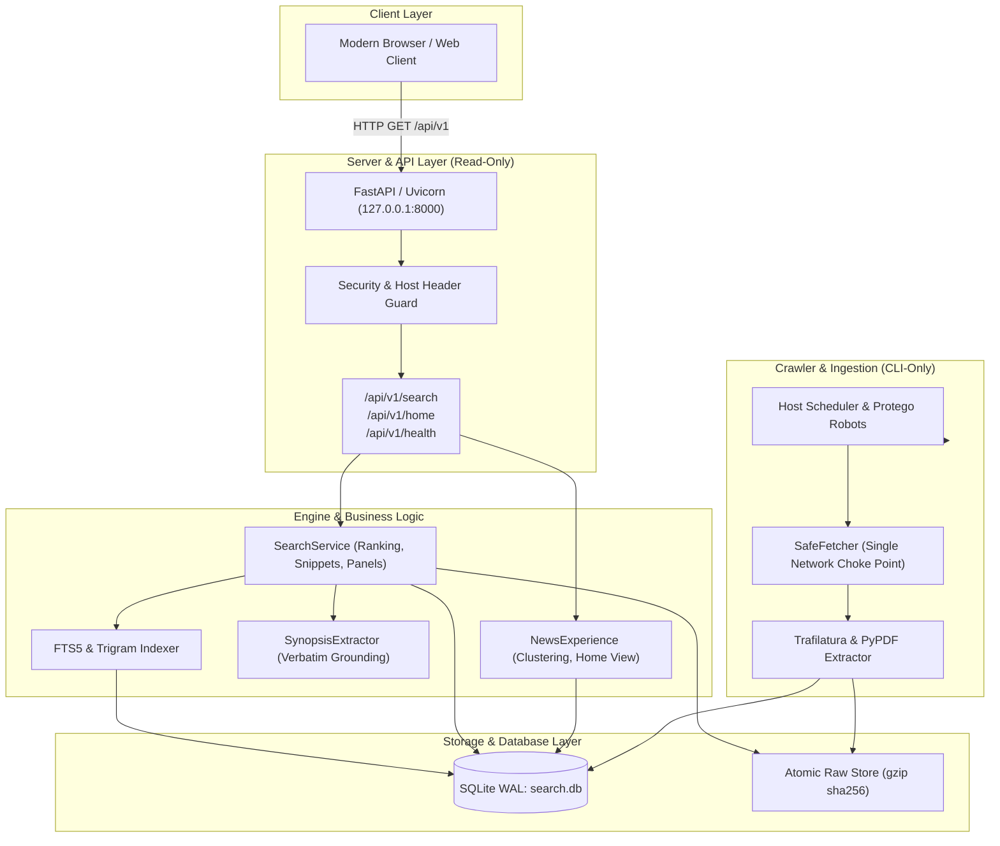

# Architecture Specification: Independent Search Engine v0.1.0

This document describes the high-level architecture, module boundaries, data flow, safety invariants, and concurrency model of Independent Search Engine v0.1.0.

---

## 1. System Overview

Independent Search Engine is a self-hosted, privacy-preserving search engine designed to run entirely on a personal Windows computer. It operates without external search APIs, third-party tracking, or cloud dependencies.



---

## 2. Core Architectural Principles & Invariants

The architecture enforces strict design invariants (Section 5 of `BUILD_PLAN.md`):

1. **One Network Door (S1)**: All outbound network traffic must pass through `SafeFetcher` in `crawler/fetcher.py`. Only `src/search_engine/net/` may import `httpx`.
2. **No Unvalidated Connections (S3)**: Every target hostname is resolved immediately prior to connection. All addresses must be public IP addresses (rejecting private, loopback, link-local, multicast, and IPv4-mapped IPv6). Outbound connections are pinned to the validated IP.
3. **No Automatic Redirects (S4)**: `SafeFetcher` never follows redirects internally. Every redirect hop is returned to the scheduler and must pass through the full approval chain again.
4. **Unforgeable Single-Use Approvals**: Outbound requests require an unforgeable `FetchApproval` or `RobotsFetchApproval` issued exclusively by `Scheduler`. Approvals cannot be reused, exchanged, or forged.
5. **Read-Only API Server (S10)**: The HTTP API serves search results and news through `/api/v1`. All crawler, polling, backup, restore, block, and removal operations are CLI-only.
6. **100% Verbatim Grounding (S11 / Invariant 10)**: Every sentence in a synopsis panel must be an exact verbatim substring of the cited stored document. Paraphrasing or generative text is strictly forbidden.
7. **Strict Air-Gap & Preflight (S13)**: Real-mode crawling requires `real_network_enabled=true` and a cryptographic authorization manifest (`data/preflight.approved.json`) hashed from operator inputs.

---

## 3. Subsystem Breakdown

### 3.1. Network Safety (`src/search_engine/net/`)
- **`resolver.py`**: Resolves DNS records with timeouts; supports custom resolver injection for testing.
- **`ip_policy.py`**: Validates IP address classification. Enforces rejection of RFC 1918, RFC 3927, RFC 4193, CGNAT, and link-local ranges.
- **`transport.py` & `httpx_transport.py`**: Encapsulates `httpx` and `httpcore`. Binds outbound TCP sockets strictly to the validated, pinned IP while maintaining standard TLS SNI and Host headers.

### 3.2. Crawler Pipeline (`src/search_engine/crawler/`)
- **`normalize.py`**: Deterministic URL canonicalization: punycode conversion, scheme/host lowercasing, port removal, tracking parameter stripping (`utm_*`, `fbclid`, `gclid`), and query parameter sorting.
- **`urlsafety.py`**: Rejects dangerous schemes (`javascript:`, `file:`, `data:`), credential strings, internal hostnames, and malformed structures.
- **`robots.py`**: RFC 9309 conforming robots policy powered by Protego. Enforces 24-hour TTL caching, fail-closed on 5xx/timeouts, and 4xx allow-all rules.
- **`scheduler.py`**: Central politeness coordinator. Enforces per-host concurrency (1), global concurrency (8), minimum 1.0s delays, and exponential backoff with jitter.
- **`fetcher.py` (`SafeFetcher`)**: Single choke point. Enforces post-decompression byte limits (2 MiB HTML/text/feeds, 5 MiB PDF) and magic-byte content sniffing.
- **`preflight.py`**: Cryptographic integrity validation of operator-approved crawling manifests (D13).

### 3.3. Content Extraction (`src/search_engine/extract/`)
- **`html.py`**: High-accuracy HTML extraction using `trafilatura` with a `selectolax`-based fallback. Extracts title, clean text, headings, description, dates, canonical URLs, and links.
- **`pdf.py`**: Isolated subprocess extraction using `pypdf` with hard timeouts (10 seconds) and memory monitoring via `psutil`.
- **`feeds.py`**: RSS 2.0 and Atom 1.0 feed parser with XML entity protection via `defusedxml`.

### 3.4. Search & Ranking (`src/search_engine/search/`)
- **`query.py`**: NFKC normalization, whitespace collapsing, token quoting, and AND-with-OR fallback logic.
- **`ranking.py`**: BM25 scoring combined with bounded bonuses: all-terms-in-title (+15%), exact title match (+10%), phrase proximity (+15%), freshness decay, and host diversity demotion.
- **`snippets.py`**: Safe excerpt generation highlighting query terms with HTML entity escaping.
- **`service.py`**: High-level search orchestrator combining FTS retrieval, canonical deduplication, pagination, and panel generation.

### 3.5. News & Experience (`src/search_engine/experience/`)
- **`clusters.py`**: Near-duplicate story clustering using token Jaccard similarity and title overlap.
- **`synopsis.py`**: High-confidence synopsis extraction finding the single highest-scoring verbatim sentence from the top document.
- **`panels.py`**: Panel decision router (Synopsis, PreviewCard, Recent News Block).
- **`home.py`**: Home page data builder grouping news into top stories and category slices.

### 3.6. Operations & Data Integrity (`src/search_engine/operations/`)
- **`backup.py`**: Zero-downtime hot backups using SQLite Online Backup API accompanied by atomic tar snapshotting of raw storage.
- **`controls.py`**: Operator controls for blocking domains, removing URLs, pausing crawls via `data/PAUSE`, and emergency stops via `data/STOP`.
- **`retention.py`**: Automated cleanup purging news items older than 14 days and dangling raw files.

---

## 4. Concurrency & Storage Model

```text
                  +-----------------------------------+
                  |  Process 1: Web Server (Serving)  |
                  |     (Read-Only DB Connections)    |
                  +-----------------+-----------------+
                                    |
                                    v (Shared WAL Reads)
+------------------------+   +---------------+   +------------------------+
|  Process 2: News Poll  |-->| SQLite search |<--| Process 3: CLI Crawler |
|   (Exclusive Writer)   |   |   (WAL Mode)  |   |   (Exclusive Writer)   |
+------------------------+   +---------------+   +------------------------+
```

1. **SQLite WAL Mode**:
   - Write-Ahead Logging (`PRAGMA journal_mode=WAL`) enables concurrent readers while a single writer updates the database.
   - Busy timeout set to 5,000 ms to handle lock contention gracefully.
2. **Single-Writer Process Discipline**:
   - Only one operator process writes to the database at a time (crawler or news poller).
   - Server processes open database exclusively in read-only mode (`mode=ro`).
3. **Atomic File Storage**:
   - Raw documents and images are written to temporary files in the same directory, flushed, fsynced, and atomically replaced (`os.replace`).
   - Hash-addressed hierarchy (`data/raw/ab/cd/<sha256>.gz`) prevents collisions and directory bloat.
